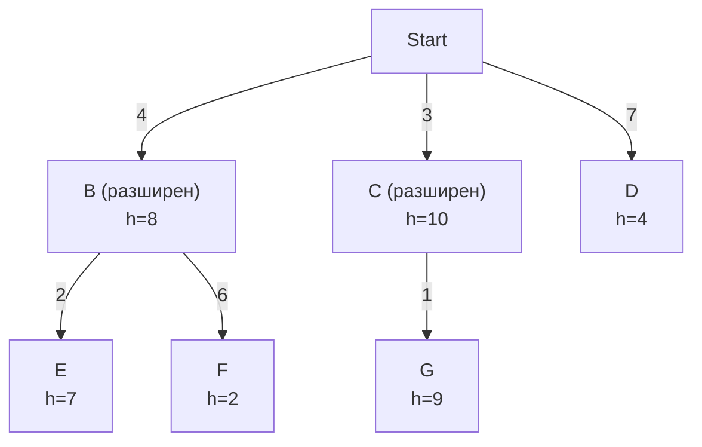
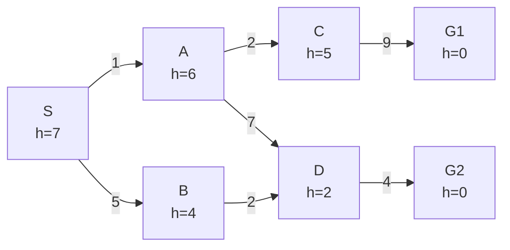
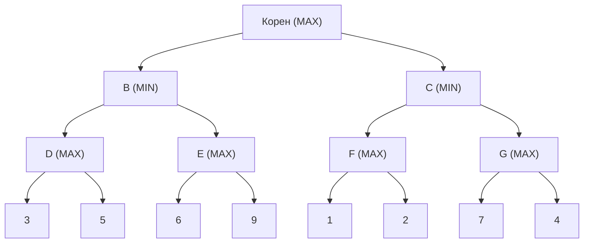

# Recap на първа част от курса

### Графика A (за въпроси 1–4)

Частично разширено дърво на търсене. Върху всяка дъга е цената на пътя, а до всеки възел е стойността на евристиката **h**, оценяваща разстоянието до целта. Възлите **B** и **C** вече са разширени. **Листа** (неразширени възли) са **D, E, F, G**.

---

### Въпрос 1
Кое ще бъде следващото разширено листо при **алчно (greedy) търсене**?

- [ ] D
- [ ] E
- [ ] F
- [ ] G

<b>Покажи отговора</b>

**F.** Алчното търсене избира листото с най-малка h. Стойностите са D=4, E=7, **F=2**, G=9.

---

### Въпрос 2
Кое ще бъде следващото разширено листо при **търсене с равномерна цена (uniform cost)**?

- [ ] D
- [ ] E
- [ ] F
- [ ] G

<b>Покажи отговора</b>

**G.** Търси се листото с най-малка g (цена от началото):
D = 7, E = 4+2 = 6, F = 4+6 = 10, **G = 3+1 = 4**.

---

### Въпрос 3
Кое ще бъде следващото разширено листо при **търсене в широчина (breadth-first)**?

- [ ] D
- [ ] E
- [ ] F
- [ ] G

<b>Покажи отговора</b>

**D.** То е на дълбочина 1, а E, F и G са на дълбочина 2. При търсене в широчина първо се разширяват най-плитките листа.

---

### Въпрос 4
Кое ще бъде следващото разширено листо при **A\***?

- [ ] D
- [ ] E
- [ ] F
- [ ] G

<b>Покажи отговора</b>

**D.** Сметката е f = g + h:

| Листо | g | h | f |
|-------|:-:|:-:|:-:|
| D | 7 | 4 | **11** |
| E | 6 | 7 | 13 |
| F | 10 | 2 | 12 |
| G | 4 | 9 | 13 |

Най-малко f има D.

---

### Графика B (за въпроси 5–8)

Графика на пространството на състоянията. **S** е начален възел, **G1** и **G2** са целеви. Цените са върху дъгите (дъгите са насочени), а h е вътре във възлите.

---

### Въпрос 5
За стратегията **A\*** посочете последователността от обходени (разширени) възли до достигане на цел.

- [ ] S A B D G2
- [ ] S A C B D G2
- [ ] S A B C D G1
- [ ] S A C G1
- [ ] S B D G2

<b>Покажи отговора</b>

**S A C B D G2**

1. Разширява се S: A (f = 1+6 = 7), B (f = 5+4 = 9).
2. Разширява се A (7): C (g=3, f=8), D (g=8, f=10).
3. Разширява се C (8): G1 (g=12, f=12).
4. Разширява се B (9): D се намира по по-добър път, g=7, f=9.
5. Разширява се D (9): G2 (g=11, f=11).
6. Разширява се G2 (11), цел. Пътят е S→B→D→G2 с цена **11** (оптимален).

---

### Въпрос 6
За **алчното търсене (greedy best-first)** посочете последователността от обходени възли до достигане на цел.

- [ ] S A C G1
- [ ] S B D G2
- [ ] S A B D G2
- [ ] S A D G2

<b>Покажи отговора</b>

**S B D G2.** От фронта {A (h=6), B (h=4)} се избира B. После от {A (6), D (2)} се избира D, после G2 (h=0).

---

### Въпрос 7
За **търсене в широчина (BFS)** посочете последователността от обходени възли до достигане на цел. Попълнете и цената на намерения път и кажете дали той е оптимален.

- [ ] S A B C D G1
- [ ] S A B D C G2
- [ ] S A C D B G1
- [ ] S B A D G2

<b>Покажи отговора</b>

**S A B C D G1.** Нива: {S}, {A, B}, {C, D}, {G1, G2}. G1 се генерира при разширяването на C, преди D да е разширен.
Цената на пътя S→A→C→G1 е 1+2+9 = **12**, а оптималният е 11 (S→B→D→G2). **BFS не е оптимален, когато дъгите имат различни цени**, защото търси най-малко стъпки, а не най-малка цена.

---

### Въпрос 8
За **търсене в дълбочина (DFS)** посочете последователността от обходени възли до достигане на цел.

- [ ] S A C G1
- [ ] S A D G2
- [ ] S B D G2
- [ ] S A C D G2

<b>Покажи отговора</b>

**S A C G1.** DFS слиза максимално дълбоко по първото (азбучно) дете: S → A → C → G1. Намереното решение не е оптимално (цена 12).

---

### Въпрос 9
Дайте **дефиниция за пълен (complete)** алгоритъм за търсене.

<b>Покажи отговора</b>

Един алгоритъм е **пълен**, ако **винаги намира решение, когато такова съществува**.

---

### Въпрос 10
Дайте **дефиниция за оптимален (optimal)** алгоритъм за търсене.

<b>Покажи отговора</b>

Един алгоритъм е **оптимален**, ако **намира решението с най-малка цена на пътя** (най-доброто сред всички решения).

---

### Въпрос 11
Кой от следните алгоритми **не е пълен** при безкрайно дълбоко пространство на състоянията?

- [ ] Търсене в широчина
- [ ] Итеративно търсене по нива (IDS)
- [ ] Търсене в дълбочина
- [ ] Търсене с равномерна цена (при положителни цени)

<b>Покажи отговора</b>

**Търсене в дълбочина.** То може да затъне в безкраен клон и никога да не намери решение, което се намира в друг клон.

---

### Въпрос 12
От какво е съставена **оценъчната функция**, която **A\*** използва, за да избира кой възел от фронта да разшири следващ?

<b>Покажи отговора</b>

**f(n) = g(n) + h(n)**, където:

- **g(n)** е реалната цена на пътя от началния възел до n;
- **h(n)** е евристичната оценка на цената на най-евтиния път от n до целта;
- **f(n)** е оценката на общата цена на най-евтиното решение, което минава през n.

A\* винаги разширява възела от фронта с **най-малка стойност на f**. Ако h е допустима (не надценява), A\* е оптимален.

---

### Въпрос 13
Евристичната функция h(n) е **допустима (admissible)**, ако:

- [ ] Никога не надвишава реалната цена на най-евтиния път от n до целта
- [ ] Винаги е равна на реалната цена до целта
- [ ] Никога не е по-малка от реалната цена до целта
- [ ] Е равна на g(n) за всеки възел

<b>Покажи отговора</b>

**Никога не надвишава реалната цена на най-евтиния път от n до целта** (не надценява). При допустима h алгоритъмът A\* (търсене в дърво) е оптимален.

---

### Въпрос 14
Кой е **основният практически недостатък на A\***?

- [ ] Не е пълен
- [ ] Не е оптимален при допустима евристика
- [ ] Пази всички генерирани възли в паметта (експоненциална памет)
- [ ] Изисква дъги с отрицателна цена

<b>Покажи отговора</b>

**Пази всички генерирани възли в паметта (експоненциална памет).** Във времево отношение A\* също е експоненциален в най-лошия случай, но на практика той остава без памет, преди да му свърши времето. A\* е пълен (при краен коефициент на разклоняване и положителни цени) и оптимален при допустима евристика. Затова съществуват варианти като IDA\*.

---

### Въпрос 15
Каква е **времевата сложност** на **търсенето в широчина (BFS)**, ако коефициентът на разклоняване е **b**, а най-плиткото решение е на дълбочина **d**?

- [ ] O(b·d)
- [ ] O(b^d)
- [ ] O(d^b)
- [ ] O(d)

<b>Покажи отговора</b>

**O(b^d).** BFS генерира 1 + b + b² + … + b^d възела (при проверка на целта при разширяване на възела: O(b^(d+1))), а последното ниво доминира сумата.

---

### Въпрос 16
Каква е **сложността по памет** на **търсенето в широчина (BFS)**?

- [ ] O(d)
- [ ] O(b·d)
- [ ] O(b^d)
- [ ] O(b)

<b>Покажи отговора</b>

**O(b^d).** BFS пази във фронта (и в списъка на посетените възли) цялото последно ниво, което съдържа експоненциално много възли. Поради това паметта, а не времето, често е ограничаващият фактор.

---

### Въпрос 17
Кое твърдение за **търсенето в дълбочина (DFS)** е вярно? (m е максималната дълбочина на пространството на състоянията)

- [ ] Време O(b^d), памет O(b^d)
- [ ] Време O(b^m), памет O(b·m)
- [ ] Време O(b·m), памет O(b^m)
- [ ] Време O(m), памет O(1)

<b>Покажи отговора</b>

**Време O(b^m), памет O(b·m).** В най-лошия случай DFS посещава всички възли до дълбочина m. Паметта е линейна, защото се пази само текущият път и неразширените братя на възлите по него. Забележете, че m може да е много по-голямо от d.

---

### Въпрос 18
Кое твърдение за **итеративното търсене по нива (IDS)** е вярно?

- [ ] Време O(b^d), памет O(b·d)
- [ ] Време O(b^d), памет O(b^d)
- [ ] Време O(b·d), памет O(b^d)
- [ ] Време O(b^(2d)), памет O(b·d)

<b>Покажи отговора</b>

**Време O(b^d), памет O(b·d).** IDS съчетава добрата памет на DFS с пълнотата и оптималността на BFS (при равни цени). Повторното обхождане на горните нива не променя асимптотиката, защото най-голям е броят на възлите на последното ниво.

---

### Въпрос 19
От какво зависи **времевата сложност на търсенето с равномерна цена (Uniform cost)**?

- [ ] Само от дълбочината d на най-плиткото решение
- [ ] От цената C\* на оптималното решение и минималната цена ε на дъга
- [ ] Само от максималната дълбочина m
- [ ] От броя на целевите състояния

<b>Покажи отговора</b>

**От цената C\* на оптималното решение и минималната цена ε на дъга:** $O(b^{\lceil C^*/ε \rceil})$. UCS разширява всички възли с цена на пътя по-малка от C\*, а това не е свързано директно с дълбочината d. Ако всички дъги имат еднаква цена, UCS се държи като BFS.

---

### Въпрос 20
Кой алгоритъм има **линейна** сложност по памет спрямо дълбочината на решението?

- [ ] Търсене в широчина
- [ ] Търсене в дълбочина
- [ ] Търсене с равномерна цена
- [ ] A\*

<b>Покажи отговора</b>

**Търсене в дълбочина**, O(b·m). То пази само текущия път и неразширените братя по него. BFS, UCS и A\* пазят целия фронт, а той расте експоненциално.

---

### Въпрос 21
Коефициентът на разклоняване е **b = 2**, а решението е на дълбочина **d = 3**. Колко възела най-много генерира **BFS** до дълбочина 3 (включително корена)?

- [ ] 8
- [ ] 14
- [ ] 15
- [ ] 26

<b>Покажи отговора</b>

**15.** 1 + 2 + 4 + 8 = 15 (т.е. 2⁴ − 1).

---

### Въпрос 22
При същите **b = 2** и **d = 3**, колко възела общо генерира **IDS** (сумата за всички итерации с граници на дълбочината 0, 1, 2 и 3)?

- [ ] 15
- [ ] 22
- [ ] 26
- [ ] 30

<b>Покажи отговора</b>

**26.**

| Граница | Генерирани възли |
|:-:|:-:|
| 0 | 1 |
| 1 | 1 + 2 = 3 |
| 2 | 1 + 2 + 4 = 7 |
| 3 | 1 + 2 + 4 + 8 = 15 |
| **Общо** | **26** |

Това е само малко повече от 15 при BFS, т.е. излишната работа е малка.

---

### Въпрос 23
Сравнете **итеративното търсене по нива (IDS)** с **търсенето в широчина (BFS)**. Посочете по една прилика и една разлика.

<b>Покажи отговора</b>

- **Прилика:** при равни цени на дъгите и двата са пълни и оптимални.
- **Разлика:** IDS използва O(b·d) памет, а BFS O(b^d). IDS повтаря обхождането на горните нива, но тази излишна работа е малка, защото повечето възли са на последното ниво.

---

### Въпрос 24
Дайте примери за **локално търсещи алгоритъми**.

<b>Покажи отговора</b>

- Hill climbing (изкачване на хълм), включително с **random restart**
- Simulated annealing
- Local beam search
- Генетични алгоритми

---

### Въпрос 25
Дайте примери за **глобално търсещи алгоритъми**.

<b>Покажи отговора</b>

- Търсене в широчина (BFS)
- Търсене в дълбочина (DFS)
- Търсене с равномерна цена (Uniform cost)
- Итеративно търсене по нива (IDS)

---

### Въпрос 26
Кой от следните алгоритми използва **константна памет O(1)** (не пази пътя)?

- [ ] Търсене в широчина
- [ ] Търсене в дълбочина
- [ ] Hill climbing
- [ ] Търсене с равномерна цена

<b>Покажи отговора</b>

**Hill climbing.** Той пази само текущото състояние и оценката му. Local beam search с широчина k пази k състояния, т.е. O(k) памет, а DFS пази цял път, т.е. O(b·m).

---

### Въпрос 27
Какво е **мутация (mutation)** в генетичния алгоритъм и защо е необходима?

<b>Покажи отговора</b>

Мутацията е оператор, който с **малка вероятност** случайно променя един или няколко гена на индивид. Тя запазва **разнообразието** в популацията и помага алгоритъмът да не се затлачи в локален оптимум, защото въвежда информация, каквато я няма в родителите (кръстосването само комбинира съществуващото).

---

### Въпрос 28
Какво е **кръстосване (crossover)** в генетичните алгоритми?

<b>Покажи отговора</b>

Кръстосването е **генетичен оператор**, който **комбинира частите от генетичния материал на два родителя**, за да създаде един или два потомъка.

Пример (едноточково, точка на рязане след 3-ия ген):

| | Преди | След |
|---|---|---|
| Родител 1 | 110 \| 010 | Дете 1: 110 **111** |
| Родител 2 | 001 \| 111 | Дете 2: 001 **010** |

Видове: едноточково, двуточково, равномерно (uniform). Кръстосването пренася и комбинира добри части от решенията, докато мутацията въвежда нова информация.

---

### Въпрос 29
Какво е **селекция (selection)** в генетичните алгоритми?

<b>Покажи отговора</b>

Селекцията е **етапът, в който се избират индивидите от текущата популация, които ще се размножават** (или ще оцелеят за следващото поколение).

Често използвани методи:

- **Рулетка (пропорционално на fitness)**, при която вероятността за избор е fitness(i) / сумата от всички fitness стойности;
- **Турнирна селекция**, при която се избират k случайни индивида и печели най-добрият;
- **Ранг селекция**, при която вероятността зависи от ранга, а не от абсолютната стойност;
- **Елитизъм**, при който най-добрите индивиди се прехвърлят директно в следващото поколение.

---

### Дърво на играта (за въпроси 30–31)

Макс е на ред (корен). Играта е без случайност. Обхождането е отляво надясно. Стойностите в листата са от статичната оценка.

---

### Въпрос 30
Приложете **Мини-Макс** и запишете стойностите на междинните възли. Кой е правилният ход на Макс?

<b>Покажи отговора</b>

- D = max(3, 5) = **5**
- E = max(6, 9) = **9**
- F = max(1, 2) = **2**
- G = max(7, 4) = **7**
- B = min(5, 9) = **5**
- C = min(2, 7) = **2**
- Корен = max(5, 2) = **5**

Правилният ход е към **B**.

---

### Въпрос 31
Приложете **алфа-бета отсичане**. Кои възли **не е необходимо** да бъдат оценени? Обяснете защо.

<b>Покажи отговора</b>

Не е необходимо да се оценяват:

1. **Листото със стойност 9** (второто дете на E). След D = 5 във възела B (MIN) имаме β = 5. Първото листо на E е 6 ≥ 5, значи E ≥ 6, а MIN във B никога няма да избере E. Остатъкът от E е излишен.
2. **Възелът G заедно с листата 7 и 4.** След B = 5 в корена α = 5. Във C (MIN) след F = 2 имаме C ≤ 2 < α, значи MAX в корена никога няма да избере C. Останалите деца на C са излишни.

Резултатът е същият като при Мини-Макс: корен = 5.

---

### Въпрос 32
Кой от следните алгоритми се използва за решаване на CSP?

- [ ] A\*
- [ ] Търсене в дълбочина с връщане назад (backtracking)
- [ ] Търсене в широчина
- [ ] Uniform-cost search

<b>Покажи отговора</b>

**Търсене в дълбочина с връщане назад (backtracking).** Често се подобрява с евристики (MRV, степенна евристика), forward checking и съгласуване на дъгите.

---

### Въпрос 33
Какво са **домейните (domains)** в задача за удовлетворяване на ограничения (CSP)?

<b>Покажи отговора</b>

CSP се задава като тройка **(X, D, C)**:

- **X** е множество от променливи;
- **D** е множество от **домейни**, по един за всяка променлива. Домейнът D_i е множеството от допустимите стойности, които променливата X_i може да приеме;
- **C** е множество от ограничения.

Пример: при оцветяване на карта променливите са областите, а домейнът на всяка е {червено, зелено, синьо}. В процеса на решаване домейните се стесняват (forward checking, arc consistency).

---

### Въпрос 34
Какви **типове** могат да бъдат **ограниченията** в CSP? Дайте примери.

<b>Покажи отговора</b>

По брой на участващите променливи:

- **Унарни**, върху една променлива. Пример: X ≠ 3.
- **Бинарни**, върху две променливи. Пример: X < Y или „съседните области имат различен цвят“.
- **Ограничения от по-висок ред (глобални)**, върху три или повече променливи. Пример: **AllDifferent**(X₁, …, Xₙ) или „X + Y = Z“.

По строгост:

- **Твърди (hard)**, които трябва да бъдат изпълнени.
- **Меки (soft, предпочитания)**, чието нарушаване се допуска срещу цена.

